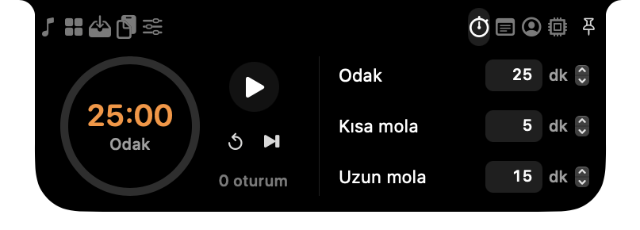
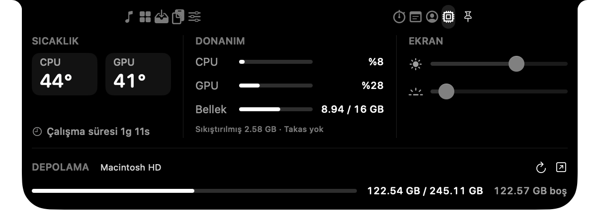
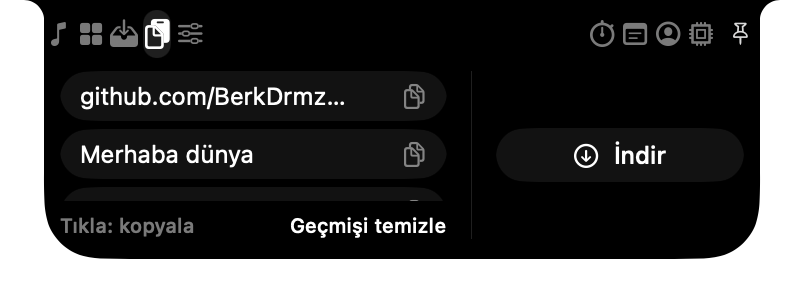
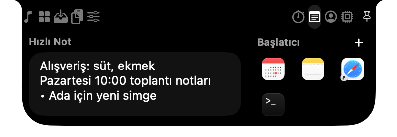
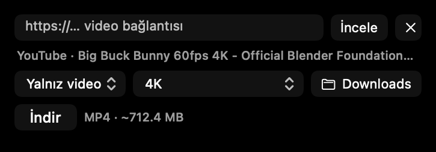
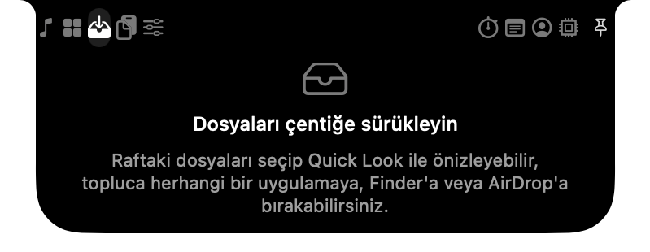
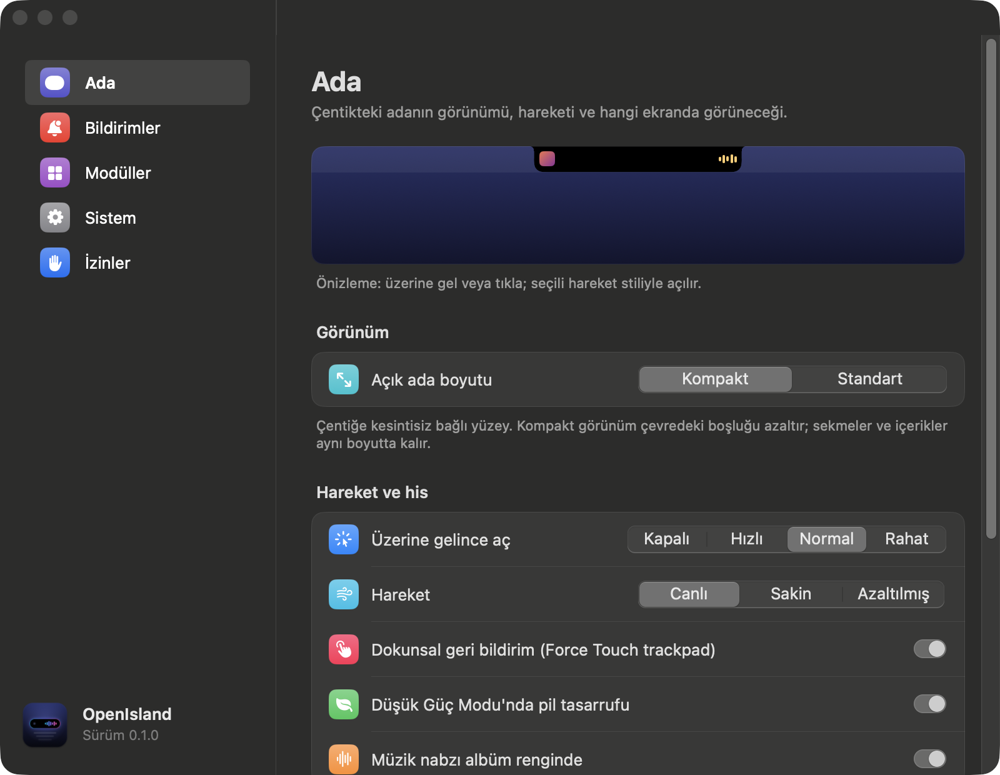

# OpenIsland

OpenIsland, MacBook için geliştirilen ücretsiz ve açık kaynaklı bir Dynamic Island uygulamasıdır.
Müzik kontrollerini, bildirimleri ve günlük araçları ekranın üst kısmında bir araya getirir.
Swift ile geliştirilmiştir; günlük kullanılan sürümün arayüzü AppKit ve Core Animation'dır ([App/](App/README.md)).
Boşta gereksiz işlem yapmamaya odaklanır.

<p align="center">
  
  
</p>

| Özellik | Uygulama |
|---|---|
| Medya + ses nabzı | Spotify, Müzik, tarayıcılar (MediaRemote / adapter / AppleScript), albüm kapağı, tıklanıp sürüklenebilen süre çubuğu (desteklemeyen kaynakta salt okunur), ses kaydetmeyen ve analiz etmeyen, Core Animation ile çalışan tahmini ve organik amber müzik nabzı, kapağa/başlığa tıklayınca çalan uygulamaya geçiş |
| Ses göstergesi | Jest ve kaydırıcıyla yapılan ses değişimi adada görünür; ses, parlaklık ve klavye ışığı tuşları macOS'un kendi göstergesine bırakılır (tuş yakalama ve parlaklık için private çerçeve yok) |
| Quick Mirror | FaceTime kamerası, aynalı daire önizleme |
| Hover ile açılma | Ön ayarlar: Kapalı / Hızlı (60 ms) / Normal (100 ms) / Rahat (250 ms); ayrılınca söner; ⌃⌥⌘I ile klavyeden, Esc ile kapanır |
| Geçici bildirimler | Pil/şarj (adaptör, %20, %10, %100), AirPods/kulaklık bağlandı-ayrıldı, parça değişimi, toplantı hatırlatması, Pomodoro, indirme/aktarım sonucu, AirDrop, kilit açma, ağ yolu değişimi, harici ekran — tek sunum modeli, deterministik öncelik |
| Canlı etkinlikler | Kanatlarda indirme/aktarım halkası ve yüzde (App Store dahil, macOS ilerleme yayını sağladığında), Pomodoro geri sayımı, çalan müzik |
| Dosya rafı | Çift bölge (raf + AirDrop), çoklu seçim, Quick Look, topluca sürükleme, yeniden açılışta kalıcı, Fotoğraflar/Mail'den file promise; dosya işlemleri: Zip'le, Arşivi aç, Resmi sıkıştır, Yolu kopyala |
| Araçlar | Pano geçmişi + bağlantıdan indirme, Pomodoro, takvim (etkinlik → Takvim'de açılır, Katıl → toplantı), Apple Anımsatıcılar (bugün, tamamla, ekle; başlık → Anımsatıcılar), Quick Notes, uygulama/bağlantı/Shortcuts başlatıcı; isteğe bağlı kaldırıcı ve önbellek temizleyici |
| Sistem | Eşit yükseklikte CPU/GPU, bellek ve ekran kontrol sütunları; disklerin kullanılabilir alanı. Sıcaklık, eşleşen sensör grubunun son okumadaki en yüksek geçerli değeridir; ortalama veya geçmiş tepe tutulmaz. CPU/GPU sensör gruplaması belgelenmemiştir. Canlı ölçüm yalnızca sekme görünürken çalışır; desteklenmeyen sensörler değer uydurmadan gösterilir |
| Ses Mikseri | Çıkış, sistem sesi ve mikrofon aygıtları; uygulama bazında ses seviyesi ve çıkış yönlendirme. macOS 14.2+ Core Audio desteği ve sistem sesi izni gerekir; ses dosyası kaydedilmez. Varsayılan seviyede ses işleme yolu kurulmaz |
| Son pencerede çıkış | Ayarlar → Genel'den yönetilir. Erişilebilirlik izniyle son pencerenin kırmızı düğmesi uygulamadan normal çıkış ister; diğer pencereler, kaydetme uyarıları ve Finder korunur |
| Bağlantıdan indirme | Pano'daki **İndir**: YouTube, Facebook, X ve TikTok video bağlantısı; **Video + ses / Yalnız video / Yalnız ses**, kaynakta gerçekten bulunan kaliteler (büyütme yok), yeniden kodlamadan birleştirme. YouTube için isteğe bağlı motor ilk kullanımda onayla indirilir — ayrıntılar aşağıda |
| Bağlantı temizleme | Pano'daki bağlantıya sağ tık → **Takipsiz bağlantıyı kopyala**. Yalnızca tanımlı UTM/tıklama takip parametrelerini çevrimdışı kaldırır; asıl geçmiş kaydını ve diğer parametreleri korur. Bilinen imzalı/kimlik bilgili bağlantılar değiştirilmez; otomatik izleme veya ağ isteği yoktur |
| Dock pencere önizlemeleri | Dock simgesine gelince yapay bekleme olmadan uygulamanın açık ve küçültülmüş pencere kartları açılır; küçük resimler hazır oldukça yüklenir; önizlemeye tıklayınca seçili pencereye geçilir. Ayarlar → Genel'den kapatılabilir. Erişilebilirlik ve ekran erişimi gerekir; gösterilen kartlar için tek kare alınır, ses/video/dosya kaydı ve boşta pencere taraması yapılmaz. Panel kapanınca görüntüler bırakılır |
| Jestler | İki parmak yatay: parça (yön ters çevrilebilir); dikey: ses |
| Ada menüsü | Sağ tık: adayı aç/kapat, açık tut, demo modu (ekran kaydı için ada kendiliğinden kapanmaz), Ayarlar, Çık |
| Çentiksiz ekranlar | Harici monitör ve çentiksiz Mac'lerde menü çubuğunun hemen altında yüzen ada |
| Tam ekran | Akıllı (varsayılan) / Her zaman göster / Her zaman gizle |
| Ayarlar | Canlı ada önizlemesi (bu Mac'in ölçülen çentiğiyle), Hareket (Canlı ~0,25 sn açılış / Sakin / Azaltılmış), Nook düzeni (Sade / Dengeli / Üretkenlik), modül aç/kapa |
| Albüm renginde nabız | Müzik nabzı çalan parçanın kapak rengini alır (siyah üzerinde okunur kalacak kadar açılır; gri kapakta amber); ayarla kapatılabilir |
| Pil tasarrufu | Düşük Güç Modu açıkken veya Mac ısındığında müzik nabzı sabitlenir, hareket kısalır (ayarla kapatılabilir) |

Boşta düşük CPU kullanımı hedeflenir. Animasyonlar ve aktif özellikler işlem gerektirir;
CPU, GPU ve pil tüketimi cihaz, macOS sürümü ve kullanım koşullarına göre değişir.
Dock önizlemeleri görünür kart başına küçük bir tek kare alır; statik paneli tekrar yakalamaz.
Ses mikseri varsayılan %100 seviyede ve varsayılan çıkışta ses işleme yolu kurmaz; ara seviyelerde
ses örneklerini işlemek gereklidir. Aktif animasyon veya ses işlemi için sıfır tüketim garanti edilmez.

**3 Kasım 2026 AppKit güncellemesi:** yumuşak aç/kapa hareketi korunurken, Core Animation'ın
zaten çizdiği yüzey için gereksiz ikinci istemci kare döngüsü kaldırıldı. Medya, HUD ve diğer
istemci güncellemelerini gerektiren durumlar mevcut tam hızlı yolu kullanmaya devam eder.
Sınırlı Nook hover karşılaştırmasında açılış başına süreç CPU süresi 27,197 → 14,419 ms,
kapanış başına 20,754 → 11,865 ms oldu. Bunlar anlık CPU yüzdesi veya pil ömrü kazanımı değildir.
Arka plan yükü eşleştirmeli alternatif protokol, temiz-sistem kabul ölçümüyle eşdeğer değildir.
Koşullar, doğrulamalar ve GPU/enerji sınırları: [Performans raporu](Docs/PERFORMANCE.md).
Eski tarihli sonuçlar yeni sürümün ölçümü olarak kullanılmamalıdır.

App Store indirmeleri, sistemin `NSProgress` yayını üzerinden olay tabanlı izlenir; sürekli
klasör taraması veya ağ sorgusu yapılmaz. TestFlight indirmesinde başlangıç, ilerleme ve bitiş
doğrulandı. macOS/App Store'un bu yayını sağlamadığı durumlarda yüzde gösterilemez.

Ayrıntılı teknik mimari: [Docs/ARCHITECTURE.md](Docs/ARCHITECTURE.md)

## Ekran görüntüleri

| | |
|---|---|
|  |  |
| Pano geçmişi ve **İndir** | Hızlı not ve uygulama başlatıcı |
|  |  |
| Bağlantıdan indirme: tür ve kalite | Dosya rafı |

<p align="center"></p>

Görüntüler örnek verilerle, yalıtılmış bir test ortamında alınır; gerçek takvim, pano, not veya rafa dokunulmaz
(`App/Tests/ReadmeShots.swift`).

## Bağlantıdan indirme

Pano sekmesindeki **İndir** düğmesi bir bağlantı kutusu açar. **İncele** kaynakta gerçekten bulunan kaliteleri listeler;
sunulmayan basamaklar nedeniyle birlikte devre dışı gösterilir, sessizce başka kaliteye düşülmez.

- **Video + ses:** ayrı görüntü ve ses akışları AVFoundation ile yeniden kodlamadan MP4'e birleştirilir.
- **Yalnız video:** ayrı görüntü akışı varsa yalnız o indirilir; yoksa birleşik dosyanın görüntü izi yeniden kodlamadan
  ayrılır (sessiz MP4).
- **Yalnız ses:** kaynağın ses biçimi korunur; MP3'e dönüştürülmez.
- Dosya adı başlıktan güvenli biçimde üretilir, var olan dosyanın üzerine yazılmaz; kayıt klasörü seçilebilir,
  sonuç Raf'a eklenebilir.

**Facebook, X ve TikTok** uygulamanın içinde çözülür: yardımcı süreç yoktur, her inceleme kendi geçici oturumunu kullanır
ve çerezler yalnız bellekte tutulur.

**YouTube** için uygulamada motor gelmez. İlk YouTube bağlantısında aynı panelde onay istenir; onaylanırsa
[yt-dlp](https://github.com/yt-dlp/yt-dlp) (klasör sürümü, yalnız bu Mac'in mimarisi) ve YouTube'un JS sınamasını çözen
[QuickJS](https://github.com/quickjs-ng/quickjs) GitHub sürüm sayfalarından indirilir (~55 MB indirme, ~72 MB disk):

- Sürüm ve SHA-256 özeti sabittir; eşleşmeyen dosya kurulmaz. Her çalıştırmadan önce imza denetlenir.
- Motor yalnız inceleme ve indirme sırasında, ayrı süreçte ve düşük öncelikte (utility QoS) çalışır; iş bitince kapanır.
  Boştayken süreç, zamanlayıcı veya ağ isteği yoktur.
- YouTube sayfası ve JS sınaması incelemede bir kez çözülür; indirme incelemenin sonucunu kullanır.
- Güncelleme yalnız kullanıcı **Motoru güncelle** derse yapılır; GitHub'ın bildirdiği özetle doğrulanır, yeni sürüm
  çalışmazsa eskisine dokunulmaz.
- YouTube DASH dosyalarında süre, parçalı MP4 başlığından okunur (AVFoundation'ın iki katı okuduğu süre düzeltilir).
- M3 ve sonrası AV1'i donanımda çözdüğü için 1440p/4K (AV1) de yeniden kodlamadan alınabilir.

2 Kasım 2026'da M4 MacBook Air'de önceki sürümle karşılaştırma: boşta CPU %0,041 ↔ %0,041, uygulama GPU'su 0;
aç/kapa takılmaları aynı düzeyde; 1080p YouTube indirmesi (257 MB, ~20 sn, toplam ~1,7 sn CPU) sürerken ada
akıcılığı değişmedi.

YouTube'un [kullanım şartları](https://www.youtube.com/t/terms) video indirmeyi genel olarak sınırlar. Özellik kişisel
kullanım içindir ve motor yalnız kullanıcı açıkça onaylarsa indirilir.

## Gereksinimler

- macOS 14 Sonoma veya üzeri.
- Güncel AppKit derlemesi derlemenin yapıldığı Mac'in mimarisini kullanır; doğrulanan cihaz Apple Silicon'dur.
- Çentiksiz MacBook ekranlarında yüzen kapsül görünümü desteklenir.
- Intel cihazlarda ve tüm cihaz/macOS kombinasyonlarında çalışma henüz doğrulanmamıştır.
- Spaces sabitleme davranışı özel macOS API'lerinden yararlanır. Bu API'ler kullanılamazsa
  public pencere davranışına geçilir; geçiş animasyonundaki sabitlik macOS sürümüne göre değişebilir.
- Swift 6 araç zinciri ve macOS SDK'sı gerekir. Güncel paket ve testler Xcode ile doğrulanmıştır.
  Paylaşılan kaynaklarda SwiftUI de bulunduğu için yalnız Command Line Tools ile AppKit paketi
  derlemek tüm SDK sürümlerinde doğrulanmış değildir.

## Derleme ve çalıştırma

```bash
./App/build.sh
open App/build/OpenIsland.app
```

Betik, anahtar zincirinde bir "Apple Development" veya "OpenIsland Local Signing" kimliği varsa
onu kullanır; yoksa ad-hoc imzalar. Aynı paket kimliği ve imza gereksiniminin korunması,
macOS izinlerinin yeniden derlemelerde korunması için önemlidir; ad-hoc derlemelerde yeniden izin gerekebilir. Apple Developer hesabı
olmadan izinlerin her derlemede sıfırlanmaması için bir kez `./Scripts/create-dev-identity.sh`
çalıştırın: yerel, kendinden imzalı bir kimlik oluşturur ve betik sonraki derlemelerde onu kullanır.

Kurulu uygulama açıksa yeni paketi aynı anda başlatmayın. Bu komut kurulu uygulamayı
otomatik değiştirmez. Güncel AppKit girişi `App/Sources` altındadır; `Package.swift` içindeki
`OpenIsland` hedefi ve `Scripts/build-app.sh` eski SwiftUI arayüzünü derler, güncel AppKit paketini değil.
İmza kimliğini açıkça seçmek için:

```bash
CODESIGN_IDENTITY="Developer ID Application: Ad Soyad (TEAMID)" ./App/build.sh
```

Durum makinesi, yerleşim motoru, güç/tam ekran kuralları, özel API hata politikası ve müzik nabzı deseni testleri:

```bash
swift test
```

Yalnızca Command Line Tools varsa uygulama hedefi (`@State` makrosu) derlenemez; yalnızca test hedefini
derleyip çalıştırın (Swift Testing eklentisinin yolu verilmelidir):

```bash
swift build --target IslandCoreTests -Xswiftc -plugin-path -Xswiftc /Library/Developer/CommandLineTools/usr/lib/swift/host/plugins/testing
```

```bash
swift test --skip-build -Xswiftc -plugin-path -Xswiftc /Library/Developer/CommandLineTools/usr/lib/swift/host/plugins/testing
```

## Bakım araçları

Menü çubuğu → **Araçlar…**, adanın sağ tık menüsü veya Nook → Kısayollar başlığındaki araç simgesi aynı pencereyi açar. Adanın boyutu ve mevcut sekmeler korunur.

- **Kaldırıcı:** `/Applications` ve `~/Applications` içindeki uygulamayı seçip **Kalıntıları tara**. Uygulama kimliğiyle eşleşen önbellek, tercihler, günlükler ve kaydedilmiş pencere durumu listelenir. Kişisel uygulama verileri ve yalnızca ada göre eşleşen klasörler ayrıca seçilir. Açık uygulamalar, OpenIsland, sistem uygulamaları, sembolik bağlantılar ve paylaşılan grup klasörleri kaldırılmaz. Ayrıcalıklı yardımcılar veya kimliği doğrulanamayan özel dizinler otomatik kaldırılmaz.
- **Önbellek temizleyici:** yalnızca `~/Library/Caches` taranır. Başlangıçta hiçbir öğe seçili değildir. **Tümünü seç**, yalnızca temizlenebilen öğeleri seçer; açık uygulamalarla eşleşen bilinen önbellekler ve OpenIsland'in raf çalışma dosyaları korunur. Tanınmayan önbellekleri temizlemeden önce ilgili uygulamaları kapat. Seçilen dosyalar onaydan sonra **Çöp Sepeti'ne taşınır**, kalıcı silinmez. Alan kazanmak için Çöp Sepeti'ni kendin boşaltmalısın; APFS ve yeniden oluşan önbellekler nedeniyle gösterilen dosya boyutu ile kazanılan alan farklı olabilir.

Tarama ana arayüzden ayrı, iptal edilebilir bir görevde yapılır; bölüm değişince tarama iptal edilir, pencere kapanınca görev ve iki çalışma durumu gözlemcisi bırakılır. Araçlar yalnızca Kaldırıcı ve Önbellek temizleyici içerir; uygulama güncelleme denetimi veya katalog ağı isteği bulunmaz. Timer ve sürekli disk taraması yoktur. Kullanıcı tarafından başlatılan dosya taramasının işlem ve disk maliyeti vardır.

Bakım kontrolü: `./Scripts/check-maintenance.sh`. İsteğe bağlı gerçek sürüm kaynağı kontrolü: `OPENISLAND_UPDATE_CHECK=1 ./Scripts/check-maintenance.sh` (Wireshark ve Xcode kuruluysa yalnızca sürüm bilgilerini okur).

Ses işleme ve gözlemci yaşam döngüsü kontrolü: `./Scripts/check-controls.sh`. Sistem ölçümleri ve kapandıktan sonra görevlerin durması: `./Scripts/check-system.sh`. Sıcaklık, parlaklık ve klavye ışığı desteği macOS sürümüne ve donanıma bağlıdır; Ayarlar → Modüller'den kapatılabilir.

Dock önizlemelerinin olay süzme ve gözlemci yaşam döngüsü: `./Scripts/check-dock-previews.sh`.
Mevcut erişim izinleriyle üç geçici test penceresinde gerçek görüntü ve küçültülmüş pencereye geçiş: `./Scripts/check-dock-previews.sh --live` (imleci kullanır ve test bitince eski yerine döndürür). Dock sağda/solda ve çoklu ekran yerleşimleri ayrıca saf geometri testleriyle doğrulanır. macOS'un görüntüsünü paylaşmadığı korumalı pencerelerde başlıkla seçim kullanılabilir.

## İzinler

Hiçbiri zorunlu değildir; izin verilmeyen özellik sessizce geriler. Menü çubuğundaki kapsül simgesi ›
**Ayarlar… › Sistem Erişimi** sekmesi her iznin durumunu (İzin verildi / İzin verilmedi / Kullanımda
sorulur / Desteklenmiyor) ve nedenini gösterir:

- **Erişilebilirlik**: Dock simgelerini/pencerelerini tanımak ve seçili pencereye geçmek, son pencerenin kırmızı düğmesinde normal çıkış istemek, ⌘C/⌘X pano olayları için.
- **Ekran erişimi**: yalnızca Dock önizlemelerinde gösterilen pencerelerin küçük görüntülerini almak için. Ses veya video kaydedilmez; görüntü dosyaları oluşturulmaz. İzin verilmezse pencere başlıklarıyla seçim yapılabilir.
- **Kamera**: Quick Mirror için.
- **Otomasyon (Spotify, Müzik)**: parça bilgisi ve oynatma kontrolü için.
- **Takvimler / Anımsatıcılar**: yaklaşan etkinlikler ve bugünkü anımsatıcılar için.
- **Pano, Bildirimler**: pano geçmişi ve Pomodoro bildirimi için.

## macOS 15.4+ ve web oynatıcılar (isteğe bağlı)

Apple, macOS 15.4'ten itibaren "Şimdi Çalıyor" bilgisini üçüncü taraf uygulamalara kapattı.
Spotify ve Müzik AppleScript ile her zaman çalışır. YouTube veya Safari gibi web oynatıcılar için
[ungive/mediaremote-adapter](https://github.com/ungive/mediaremote-adapter) (BSD-3) derleyin ve
çıktıları şu yapıya koyun:

```
Vendor/MediaRemoteAdapter/
├── mediaremote-adapter.pl
└── MediaRemoteAdapter.framework
```

Bu otomatik paketleme eski `Scripts/build-app.sh` yoluna aittir. Güncel `App/build.sh`,
bu isteğe bağlı adaptörü kopyalayıp imzalamaz; adaptörün bu AppKit paketinde hazır geldiği varsayılmamalıdır.

## Proje yapısı

```
Sources/
├── IslandCore/            Saf mantık (AppKit yok, test edilir)
│   ├── IslandMachine.swift      Durum makinesi (reducer + efektler)
│   ├── IslandLayout.swift       Görünüm başına boyut ve köşe yarıçapları
│   ├── PowerRules.swift         Pil/şarj bildirim geçişleri
│   ├── FullscreenRules.swift    Tam ekran algılama kuralı
│   ├── LevelControl.swift       Ses seviyesi yazımı için hata politikası
│   ├── ShelfOperations.swift    Raf dosya işlemlerinin kuralları
│   ├── BackendHealth.swift      Arka uç sağlığı + sınırlı geri çekilme
│   └── CompactPulse.swift       Tahmini müzik nabzı desenleri
└── OpenIsland/
    ├── App/               Giriş noktası, DI kökü, koordinatör
    ├── Window/            NotchPanel (+ tracking area), ScreenManager, NotchWindowController
    ├── Island/            IslandViewModel (animasyon + efekt çalıştırıcı)
    ├── UI/                IslandDesign (token/yaylar), IslandShape, CA bileşenleri, görünümler
    ├── Features/          Media, HUD, Shelf, Mirror, Clipboard, Focus, Notes, Gestures, Events
    └── System/            İzinler, ayarlar, yardımcılar
Support/                   Info.plist, entitlements
App/Sources/              Güncel AppKit + Core Animation arayüzü
App/Tests/                Native UI ve animasyon kontrat kontrolleri
App/build.sh              Güncel AppKit .app paketleme ve imzalama
Scripts/build-app.sh      Eski SwiftUI .app paketleme ve imzalama
```

## Lisans

MIT — bkz. [LICENSE](LICENSE).
